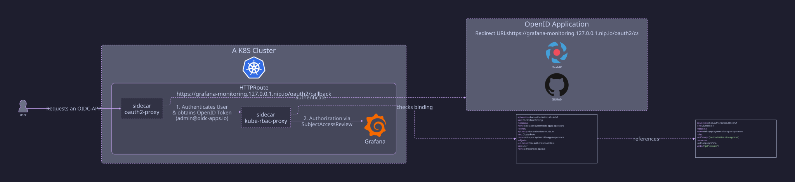

# oidc-apps

[](https://github.com/nickytd/oidc-apps/actions/workflows/build.yml)
[](https://github.com/nickytd/oidc-apps/actions/workflows/release.yml)
[](go.mod)
[](https://securityscorecards.dev/viewer/?uri=github.com/nickytd/oidc-apps)
[](LICENSE)
[](https://github.com/nickytd/oidc-apps)
[](https://pkg.go.dev/github.com/nickytd/oidc-apps)

## Usage

This controller enhances target deployments and statefulsets with side-car containers for performing OIDC authentication and Kubernetes RBAC authorization for incoming HTTP requests.

Usually applications such as `prometheus` or `grafana` do not offer any security mechanisms and delegate such responsibilities to cluster owners. This controller aims at providing a solution for bringing authentication [(oauth2-proxy)](https://github.com/oauth2-proxy/oauth2-proxy) and authorization [(kube-rbac-proxy)](https://github.com/brancz/kube-rbac-proxy)
layers in front of the targeted workloads, simplifying required configurations in a consistent way.

Targets for enhancement are identified by using labels and/or namespace selectors.
For example:

```yaml
# oidc-apps configuration (supplied via the Helm chart's values)
global:
  oauth2Proxy:
    scope: "openid email profile"
    clientId: "grafana"
    oidcIssuerUrl: "https://oidc.provider.com"
  domainName: "company.org"
  gateway:
    managed: true
    gatewayClassName: envoy
    listeners:
      - name: https
        protocol: HTTPS
        port: 443
        allowedRoutes:
          namespaces:
            from: All
        tls:
          mode: Terminate
          certificateRefs:
            - name: wildcard-tls

targets:
  - name: grafana
    namespaceSelector:
      matchLabels:
        kubernetes.io/metadata.name: monitoring
    labelSelector:
      matchLabels:
        app: grafana
    targetPort: 3000
    targetProtocol: http
    httpRoute:
      create: true
```

> **Note:** As of chart v0.4.0, Kubernetes `networking.k8s.io/Ingress` is no
> longer supported. Routing is handled exclusively via the Gateway API
> (`HTTPRoute`). The Gateway API CRDs must be installed in the cluster. The
> `global.gateway.httpRoutes.enabled` flag and per-target `ingress:` config
> have been removed; migrate `ingress:` blocks to `httpRoute:`.



## Installation

The controller is distributed as a Helm chart published as an OCI artifact to
`oci://ghcr.io/nickytd/oidc-apps/charts`. Install it with your configuration
(the `global` and `targets` values shown above):

```bash
helm install oidc-apps oci://ghcr.io/nickytd/oidc-apps/charts/oidc-apps \
  --namespace oidc-apps-system --create-namespace \
  --values values.yaml
```

See [charts/oidc-apps/values.yaml](charts/oidc-apps/values.yaml) for all
configurable values.

## RBAC Authorization

The kube-rbac-proxy sidecar performs a Kubernetes SubjectAccessReview for each
authenticated request using virtual resource attributes:

- **apiGroup:** `authorization.oidc-apps.io`
- **resource:** `oidc-apps`
- **subresource:** target name (e.g., `grafana`, `prometheus`)
- **verb:** derived from the HTTP method — `get` for `GET`/`HEAD`,
  `create` for `POST`/`PUT`/`PATCH`, etc.

Grant the verbs matching the HTTP methods your users need by binding them to a
ClusterRole:

```yaml
apiVersion: rbac.authorization.k8s.io/v1
kind: ClusterRole
metadata:
  name: oidc-apps:system:oidc-apps-operators
rules:
  - apiGroups: ["authorization.oidc-apps.io"]
    resources:
      - oidc-apps/grafana
      - oidc-apps/prometheus
    verbs: ["get", "create"]
```

See [example/oidc-apps-rbac.yaml](example/oidc-apps-rbac.yaml) for a complete example.

## Kind Demo

A fully automated local demo using Kind, Dex, and Envoy Gateway is available:

```bash
cd example/kind-setup
./setup.sh
```

See [example/kind-setup/README.md](example/kind-setup/README.md) for details.

## External Dependencies

- [oauth2-proxy](https://github.com/oauth2-proxy/oauth2-proxy)
- [kube-rbac-proxy](https://github.com/brancz/kube-rbac-proxy)

## Release Process

Releases are triggered by pushing a semver tag — the tag is the single source
of truth (there is no VERSION file):

```bash
git tag v0.0.1
git push origin v0.0.1
```

This runs the [`Release`](.github/workflows/release.yml) workflow, which:

- builds per-arch images on native runners;
- assembles `:vX.Y.Z` and `:latest` multi-arch indices for both `oidc-apps` and
  `kube-rbac-proxy` and pushes them to `ghcr.io/nickytd/oidc-apps/`;
- pushes the Helm chart to `oci://ghcr.io/nickytd/oidc-apps/charts` with
  `--version X.Y.Z --app-version vX.Y.Z`;
- creates the GitHub Release.

A failed run can be re-driven via the workflow's `workflow_dispatch` input (tag
name).

The chart `version` (the chart-shape version, distinct from `appVersion`) is
bumped manually in a separate PR when chart values change.

## Feedback and Support

Feedback and contributions are always welcome!

Please report bugs or suggestions as [GitHub issues](https://github.com/nickytd/oidc-apps/issues)
